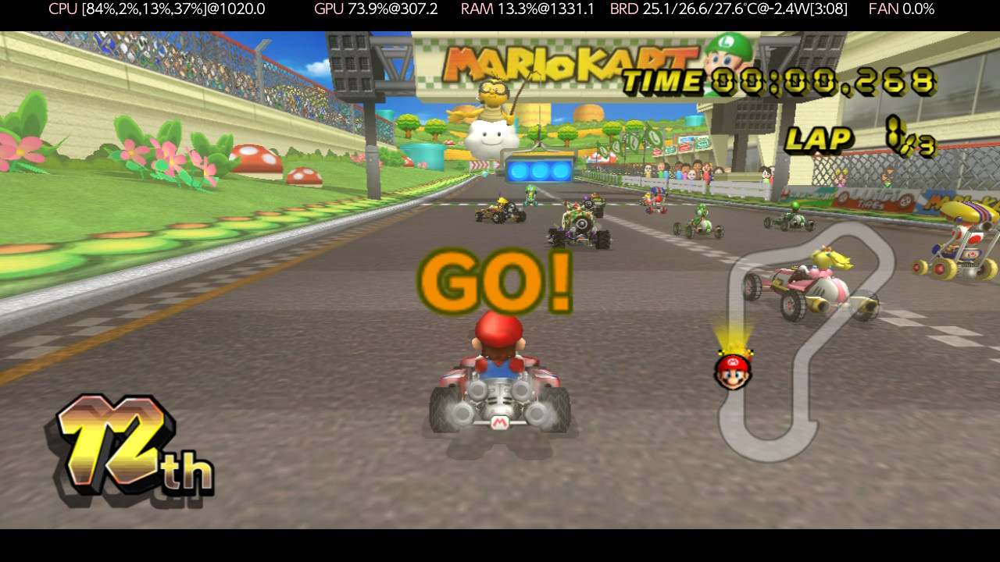
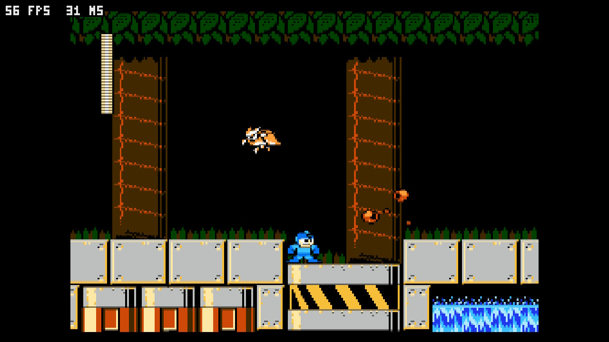
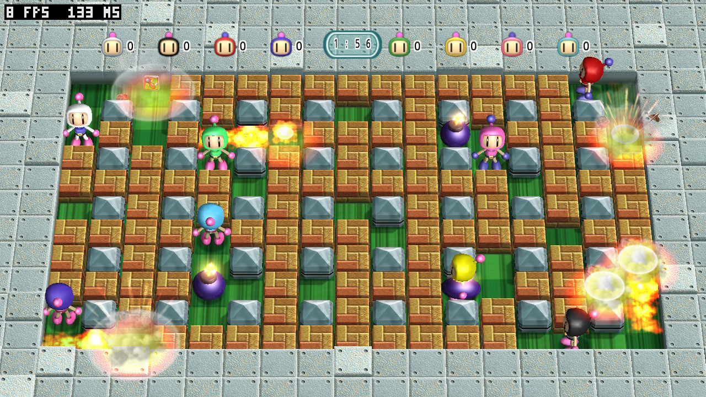
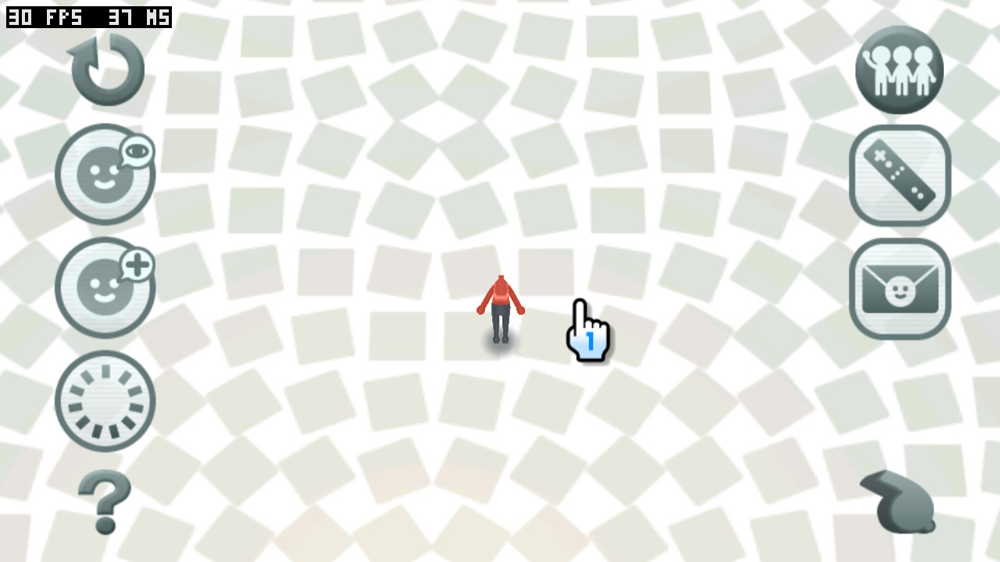

# wii-nx

**Wii games, running on your Switch.**

Not emulated. Each game is translated into a Switch program ahead of time and
runs natively, using your own disc for its files.



**This is a proof of concept, not a finished port.** One game is playable,
with races at about a fifth of full speed; everything else here is in progress, and some of
it does not run at all yet. The table below says which is which, and it is kept
honest.

The limit is the CPU, not the GPU: the game's core is full while the GPU often
idles. So the work is the runtime's own overheads, moving work to the idle
cores and the GPU, and native replacements for the libraries a game links
(libdol-nx [docs/performance.md](https://github.com/nx-mod/libdol-nx/blob/main/docs/performance.md)).

## What you need

- A Switch running homebrew
- A dump of a game you own, on the SD card
- A PC, once per game, to build it

## Getting started

1. Copy the game's `.nro` to `sdmc:/wii-nx/games/<game>/`
2. Put your disc's files beside it
3. Open it from the homebrew menu

Building a game from your dump is one command on a PC, and it happens once per
game: see [docs/install.md](docs/install.md).

## Games

| Game | Disc | State |
|---|---|---|
| Mario Kart Wii | `RMCP01` PAL | **Runs** on native graphics: menus, the flyover, races. In a race it is very slow; Miis and the race minimap are broken |
| Wii Party | `SUPP01` PAL | game 2: set up and scanned |
<!--
| New Super Mario Bros. Wii | `SMNE01` NTSC-U | being translated |
| Super Paper Mario | `R8PE01` NTSC-U | set up, not yet translated |
| Punch-Out!! | `R7PE01` NTSC-U | set up, not yet translated |
| Metroid Prime 3: Corruption | `RM3E01` NTSC-U | set up, not yet translated |
| Pikmin 2 | `R92E01` NTSC-U | set up, not yet translated |
| Wii Sports | `RSPE01` NTSC-U | set up, not yet translated |
| Wii Sports + Resort | `SP2E01` NTSC-U | set up, not yet translated |
-->

Each game is a folder in [games](games), holding what that game needs and never
the game itself.

<!--  -->

## WiiWare and Virtual Console

Titles you own as WADs are in [wads](wads), one folder each. They take two steps
a disc game does not - decrypting the WAD, and expanding the content its loader
would have - and then translate the same way.

| Title | Title ID | State |
|---|---|---|
| [Mega Man 9](wads/megaman9-nx) | `00010001/57523945` (USA) | **Plays** well; some visual glitches remain |
| [Bomberman Blast](wads/bombermanblast-nx) | USA, with the Wiimmfi patch | **Plays**, slowly (8 fps in a battle); it cannot create its save data yet |




From your WAD, with libdol-nx beside this checkout:

```sh
../libdol-nx/tools/wiinx-wad "<your title>.wad" wads/<title>/game/
../libdol-nx/tools/wiinx-build wads/<title>
```

## The Wii's own screens

The console's own titles run here too, from a NAND shared by every game — so a
Mii made once shows up everywhere. They are in [titles](titles).

| Title | Title ID | State |
|---|---|---|
| [Mii Channel](titles/miichannel-nx) | `00010002/48414341` | **Runs** pretty well; Mii heads are missing |
| [Wii Menu](titles/wiimenu-nx) | `00000001/00000002` (4.3E) | Builds; does not boot yet |


<!--  -->

Each title comes from your own console's NAND (or a Dolphin NAND of it), or is
downloaded from Nintendo the way a console does. [titles/README.md](titles/README.md)
says how.

## Homebrew

Wii homebrew runs here, and unlike games it can be handed out already built,
because it contains nothing Nintendo made.

## Your card

```
sdmc:/wii-nx/
├── config/     settings shared by every game
├── system/     the Wii itself: one NAND for all of them, and the boot ROM's fonts
└── games/      one folder per game: the program, your disc, saves, shaders
```

## Questions

**Is this legal?** Your dump stays on your machine and nothing of Nintendo's is
distributed. You build from a disc you own.

**Will my game work?** Only the ones listed. Adding one is work, not a setting.

**Do I need a PC?** Once per game, to build it. Playing does not.

## For developers

The libraries live elsewhere, and each builds on its own:

| | |
|---|---|
| [libdol-nx](https://github.com/nx-mod/libdol-nx) | everything the Wii and the GameCube share: the CPU, GX, the DSP, the SDK, the formats, the translator and the tools |
| [libwii-nx](https://github.com/nx-mod/libwii-nx) | the Wii's own: IOS, the NAND, the Wii Remote, its settings |
| [wiicompiled-nx](https://github.com/nx-mod/wiicompiled-nx) | the engine this grew from |
| [aurora-wiicompiled](https://github.com/nx-mod/aurora-wiicompiled) | headers only: games draw with libdol's own deko3d renderer, and nothing of Aurora, Dawn or Vulkan is built or linked |

Nothing is built here: libdol-nx is the toolkit, and one command of its own
turns your disc into a program. This repository holds the games, the console's
own screens, and how to set them up.

The GameCube side of the same work is [gc-nx](https://github.com/nx-mod/gc-nx).

## License

GPL-3.0-or-later. The games and the Wii's system titles are © Nintendo; none of
them are included here.
